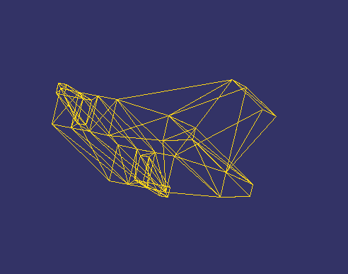

# Laboratorio 4 - Renderizado de un modelo OBJ

Este proyecto carga y renderiza una nave espacial creada en Blender.

El programa recorre los índices de las caras del archivo OBJ, obtiene los
tres vértices de cada cara y dibuja todos los triángulos en un framebuffer
implementado por software.

## Funcionalidades

- Carga de un modelo OBJ propio.
- Transformaciones mediante matrices.
- Traslación, rotación y escalado.
- Rasterización de los triángulos.
- Renderizado mediante framebuffer.

## Controles

- Flechas: mover el modelo.
- A / S: disminuir o aumentar el tamaño.
- Q / W: rotar en X.
- E / R: rotar en Y.
- T / Y: rotar en Z.

## Resultado

